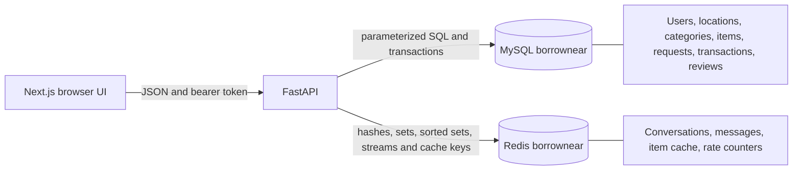
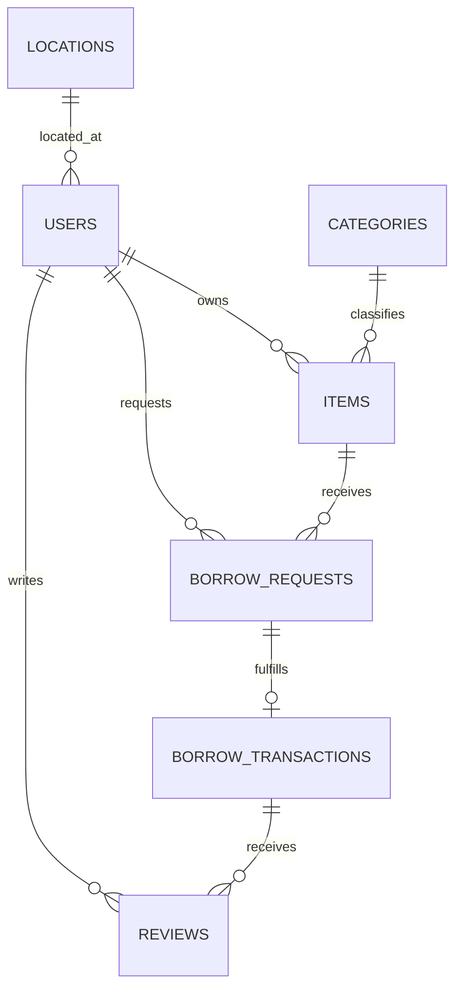

# BorrowNear data and service architecture

## Service flow

## Existing relational model

MySQL remains authoritative for identity, ownership, request states, dates, loan transactions and rating integrity. It is the durable relational source of truth for multi-row borrowing changes.

## Redis structures and key patterns

| Key pattern | Redis type | Fields / purpose | Persistence |
|---|---|---|---|
| `conversation:{id}` | Hash | request ID, item ID/name, participant IDs JSON, created and last-message timestamps | AOF, `redis_data` volume |
| `conversation:{id}:participants` | Set | Participant MySQL user IDs; membership authorization | AOF, `redis_data` volume |
| `conversation:{id}:messages` | Stream | message ID, sender ID, text, UTC timestamp; capped to latest 10,000 | AOF, `redis_data` volume |
| `request-conversation:{request_id}` | String | Unique mapping from relational request to conversation | AOF, `redis_data` volume |
| `user-conversations:{user_id}` | Sorted Set | Conversation IDs ordered by last activity epoch | AOF, `redis_data` volume |
| `cache:items:{sha256}` | String (JSON) | Item-list response for normalized filter/sort/page inputs | Ephemeral; `CACHE_TTL_SECONDS` expiry |
| `rate:messages:{user_id}:{minute}` | String integer | Per-user message send count, fixed-window limit | Ephemeral; 65-second expiry |

## Messaging lifecycle

1. The API reads a real request and its borrower/item owner from MySQL.
2. Only one of those two participants can create or retrieve the request conversation. Redis `WATCH`/`MULTI` creates the request mapping and related keys atomically.
3. Each message is appended to the conversation stream; last activity and both participant inbox sorted sets are updated.
4. Every read/write checks Redis participant-set membership. IDs are not accepted from message payloads as authorities.
5. If Redis is unavailable, messaging/readiness reports 503 rather than returning pretend data.

## Docker layout

`docker-compose.yml` at the project root defines frontend, backend, MySQL and Redis services on one private bridge network. MySQL and Redis use named persistent volumes. MySQL's published host port defaults to 3307 to keep the user's existing Workbench server on 3306 separate. First-run SQL copies under `backend/sql/docker_init/` are non-destructive and initialize only an empty Compose data directory.
